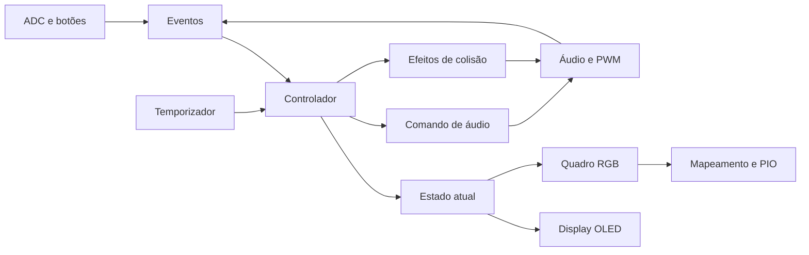

# MikaP3

Firmware `no_std` para RP2040 com player de duas vozes, matriz RGB 5×5,
display OLED, Snake, Flappy Bird e Breakout.

## Controles

**A** e **B** são os botões da placa. **J** é o botão acionado ao pressionar o
joystick; **X** e **Y** são seus eixos de inclinação. No OLED, `J2s` significa
segurar J por 2 segundos e `J3x` significa clicar em J três vezes.

### Comandos por tela

| Tela ou situação | Botão A | Botão B | Clique simples em J |
|---|---|---|---|
| Menu musical | Sem ação | Tocar a música selecionada | Sem ação |
| Música tocando ou pausada | Parar e voltar ao menu musical | Pausar ou retomar | Sem ação |
| Menu de jogos | Voltar ao menu musical | Iniciar o jogo selecionado | Ligar ou desligar a música do jogo |
| Snake em andamento | Sair para o menu de jogos | Sem ação | Sem ação |
| Flappy em andamento | Saltar | Saltar | Sem ação |
| Breakout em partida | Sair para o menu de jogos | Lançar a bola quando estiver aguardando | Sem ação |
| Game over, nos três jogos | Voltar ao menu de jogos | Reiniciar a partida | Sem ação |

A e B respondem ao apertar. O clique simples em J responde ao **soltar**.
No Flappy, cada aperto de A ou B solicita um salto; manter o botão pressionado
não repete saltos. Apertar A e B juntos solicita apenas um salto.

### Navegação pelo joystick

| Contexto | Eixo X | Eixo Y |
|---|---|---|
| Menu musical | Selecionar música | Selecionar arte da matriz LED |
| Música tocando ou pausada | Sem ação | Selecionar arte sem reiniciar a música |
| Menu de jogos | Selecionar jogo | Sem ação |
| Snake em andamento | Controlar direção | Controlar direção |
| Breakout | Sem ação | Mover a barra lateralmente |
| Flappy e game over | Sem ação | Sem ação |

As listas de músicas, artes e jogos são circulares: depois do último item,
a seleção volta ao primeiro, e vice-versa. A navegação começa imediatamente;
se mantiver o joystick inclinado, ela se repete após 350 ms e depois a cada
150 ms. Os eixos repetem de forma independente. No Snake, uma inclinação
diagonal dá prioridade ao eixo Y.

Ao mudar de tela, solte os botões que estavam apertados e centralize o joystick
antes de navegar novamente. Isso também vale ao chegar ao game over. A seleção
de música e arte é preservada ao voltar do menu de jogos.

### Trocar de modo e sair dos jogos

Segure **J sozinho por 2 segundos**:

| Situação atual | Destino |
|---|---|
| Menu musical ou reprodução | Menu de jogos; a reprodução é encerrada |
| Menu de jogos | Menu musical |
| Snake, Flappy ou Breakout, inclusive game over | Menu de jogos |

A pressão longa funciona uma vez por aperto. Soltar J depois dela não gera
clique simples; é preciso soltar antes de realizar outra pressão longa.
**Para sair do Flappy durante a partida, use J por 2 segundos**, pois A e B
estão reservados aos saltos.

### Animação do coração

1. No menu musical ou durante a reprodução, selecione a arte **CORAÇÃO** com Y.
2. Aperte e solte J três vezes, com **menos de 500 ms entre as solturas**.
3. Na terceira soltura, a animação aparece por **1,5 segundo** e depois restaura
   a tela anterior.

Se a música estiver tocando, continuará sem reiniciar. Se estiver pausada,
permanecerá pausada. Se terminar ou falhar durante a animação, o retorno será
ao menu musical. Pressão longa, outro botão, mudança de arte ou de tela
cancelam uma sequência parcial de cliques. O clique triplo não ativa a animação
nos jogos nem com outra arte selecionada.

Durante a animação, os comandos comuns ficam bloqueados. A leitura das solturas
e a combinação de reset USB continuam funcionando.

### Reset USB

Segure **A+B+J juntos por 2 segundos** para entrar no modo de gravação USB da
placa. A combinação tem prioridade sobre os comandos simples. Solte os três
botões antes de tentar acioná-la novamente.

As demais combinações de botões não executam ações simples, com a exceção de
A+B no Flappy em andamento, que solicita um único salto.

### Detalhes de leitura

A entrada é lida a cada **10 ms**. Pressão e soltura precisam permanecer
estáveis por **20 ms** para serem confirmadas, reduzindo acionamentos causados
por oscilações dos contatos. O tick dos jogos continua separado, a cada
**50 ms**; a repetição dos menus não determina a velocidade das partidas.

Os limiares dos eixos usam histerese: ativam a direção baixa em `≤1000` e a
alta em `≥3000`; liberam a baixa em `≥1400` e a alta em `≤2600`. Após uma troca
de tela, cada eixo precisa voltar à faixa central `1400..=2600` para ser
rearmado. Esses valores e a orientação física ainda precisam ser verificados
na placa, conforme a seção [Validação na placa](#validação-na-placa).

## Breakout (quebra-blocos)

Breakout é o terceiro jogo do menu, depois de Snake e Flappy. O campo completo
aparece no **OLED 128×64**: blocos, bolinha, barra e os indicadores **P**
(pontos), **V** (vidas) e **F** (fase).

1. No menu de jogos, escolha **BREAKOUT** com X. A opção **Som**, alternada com
   um clique em J, habilita ou silencia os efeitos de colisão deste jogo.
2. Aperte B para entrar. Incline **Y**, o eixo lateral na orientação atual da
   placa, para mover a barra; centralize para parar. X não move a barra.
3. Solte e aperte B novamente para lançar a bola. A bola acompanha a barra
   enquanto aguarda o lançamento. B não lança outra bola durante a jogada.
4. Rebata para destruir os blocos. O ponto de impacto na barra muda a direção
   da bola. Cada bloco precisa de um impacto e vale **10 pontos**.
5. Se a bola passar pela barra, você perde uma das **3 vidas**. Com vidas
   restantes, ela volta para a barra e aguarda um novo aperto de B.

As fases são **contínuas**: as formações alternam entre 8 colunas de 3, 4 e
5 linhas. A velocidade aumenta 0,25 pixel por tick a cada fase, começando em
2 e limitada a 4 pixels por tick no componente vertical; o ângulo da rebatida
determina o deslocamento horizontal. A barra tem 20 pixels de largura e se
move 4 pixels por tick. A física usa um tick de 50 ms; o OLED atualiza no
máximo 20 vezes por segundo.

Ao destruir o último bloco, a bola congela e os **25 LEDs comemoram durante
1 segundo** com uma sequência colorida. Depois, a próxima fase aguarda B para
lançar. Pontos e vidas são preservados. Os LEDs ficam apagados durante a
jogada. Não é preciso centralizar a barra entre vidas ou fases, mas B precisa
ser solto antes de outro lançamento.

O buzzer toca efeitos diferentes ao bater em paredes, barra e blocos, sem
música de fundo. Um efeito novo substitui o anterior; efeitos da partida
anterior não são reproduzidos ao reiniciar. Com **Som: OFF**, o jogo permanece
silencioso. Os efeitos usam uma fila fixa de 8 posições, sem fazer a física
aguardar: se ela encher, o efeito mais antigo é descartado; ao consumir a fila,
a tarefa de áudio usa o mais recente da sessão atual.

Com zero vidas, **B reinicia** com 3 vidas, fase 1 e zero pontos; depois é
necessário outro aperto para lançar. **A** ou **J por 2 segundos** voltam ao menu
de jogos, inclusive durante a comemoração da fase. Sair encerra a partida e
cancela os efeitos sonoros. Esta versão não salva recordes nem adiciona
power-ups ou vidas extras.

## Organização

O pacote contém uma biblioteca `mikap3` independente do hardware e um binário
para a placa. A biblioteca reúne o controlador da aplicação (`app`), o reconhecimento de gestos (`controls`), os tipos
de estado (`state`), o motor musical (`audio`), os catálogos (`songs` e `arts`),
os jogos e a renderização lógica (`visual`).



O ponto de entrada configura os periféricos e inicia as tarefas. `runtime`
mantém a fila de eventos com capacidade 16 e os canais `Watch`: somente a tarefa
da aplicação publica estado e comandos. Entrada e áudio enviam eventos com
espera por espaço; display e LEDs recebem o estado mais recente.

## Áudio e conteúdo

Cada reprodução tem uma sessão: pausa e troca de arte mantêm a sessão;
conclusões de sessões anteriores são ignoradas. Os jogos repetem Hino Nacional
(Snake) e Tetris (Flappy), conforme a opção de som. Breakout usa apenas efeitos
de colisão, controlados pela mesma opção. Uma falha de reprodução
volta ao menu no player ou desliga o som do jogo sem reiniciar tentativas.

Músicas e artes têm um catálogo único de nome e conteúdo. Para adicionar uma
música, gere as faixas e registre a entrada em `songs::SONGS`; navegação e OLED
obtêm os dados desse catálogo. O mesmo vale para `arts::ARTS`. Consulte
[o conversor MIDI](scripts/README.md) para gerar faixas.

Todos os conteúdos da matriz produzem um `Frame` RGB em ordem visual. O driver
de LEDs concentra o mapa da placa, a conversão para GRB e a transmissão PIO.
Animações usam prazos absolutos, e quadros iguais não são retransmitidos.

## Compilação e testes

Instale o alvo da placa e compile sem executar o runner:

```bash
rustup target add thumbv6m-none-eabi
cargo build --target thumbv6m-none-eabi
cargo build --release --target thumbv6m-none-eabi
```

O alvo padrão está configurado para a placa. Para testar a biblioteca em Linux
x86-64 sem carregar o HAL, selecione explicitamente o alvo do computador:

```bash
cargo test --lib --target x86_64-unknown-linux-gnu
```

Em outras plataformas, use o campo `host` de `rustc -vV` como alvo. Os testes
cobrem áudio, catálogos, controles, transições, temporizadores, sessões antigas,
regras dos jogos, animações, conteúdo OLED e codificação física dos LEDs.
Os testes Python e sua instalação estão documentados no conversor MIDI.

## Validação na placa

Pendente após a revisão dos controles: verificar os dois buzzers, pausa e retomada,
as 11 músicas (incluindo Tetris), seleção de artes, menus, os três jogos com
e sem som, clique triplo em J, animação do coração sem interromper a música, pressão longa
única, debounce, repetição dos eixos e reset USB. Os testes no computador e os
builds não substituem essa verificação física. Para Breakout, também estão
pendentes a orientação lateral do joystick, a fluidez e legibilidade do OLED,
a dificuldade progressiva, a comemoração dos LEDs e o volume dos efeitos.
