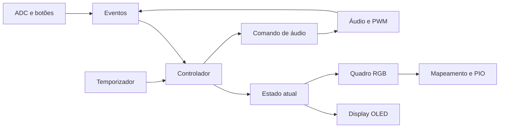

# MikaP3

Firmware `no_std` para RP2040 com player de duas vozes, matriz RGB 5×5,
display OLED, Snake e Flappy Bird.

## Organização

O pacote contém uma biblioteca `mikap3` independente do hardware e um binário
para a placa. A biblioteca reúne o controlador da aplicação (`app`), os tipos
de estado (`state`), o motor musical (`audio`), os catálogos (`songs` e `arts`),
os jogos e a renderização lógica (`visual`).



O ponto de entrada configura os periféricos e inicia as tarefas. `runtime`
mantém a fila de eventos com capacidade 16 e os canais `Watch`: somente a tarefa
da aplicação publica estado e comandos. Entrada e áudio enviam eventos com
espera por espaço; display e LEDs recebem o estado mais recente.

O controlador recebe tempo monotônico e sementes explicitamente. A entrada e
os ticks têm cadência de 50 ms. Os gestos mantêm as prioridades e limites
anteriores: navegação após 300 ms, A segurado por 2 s, clique triplo com intervalos
menores que 500 ms e reset USB com os três botões por 2 s. O easter egg dura
mais de 1500 ms, até o próximo tick, e ignora entrada durante sua execução.

Cada reprodução tem uma sessão: pausa e troca de arte mantêm a sessão;
conclusões de sessões anteriores são ignoradas. Os jogos repetem Hino Nacional
(Snake) e Tetris (Flappy), conforme a opção de som. Uma falha de reprodução
volta ao menu no player ou desliga o som do jogo sem reiniciar tentativas.

Músicas e artes têm um catálogo único de nome e conteúdo. Para adicionar uma
música, gere as faixas e registre a entrada em `songs::SONGS`; navegação e OLED
obtêm os dados desse catálogo. O mesmo vale para `arts::ARTS`. Consulte
[o conversor MIDI](scripts/README.md) para gerar faixas.

Todos os conteúdos da matriz produzem um `Frame` RGB em ordem visual. O driver
de LEDs concentra o mapa da placa, a conversão para GRB e a transmissão PIO.
Animações usam prazos absolutos, e quadros iguais não são retransmitidos.

## Compilação e testes

Instale o alvo da placa e compile sem executar o runner:

```bash
rustup target add thumbv6m-none-eabi
cargo build --target thumbv6m-none-eabi
cargo build --release --target thumbv6m-none-eabi
```

O alvo padrão está configurado para a placa. Para testar a biblioteca em Linux
x86-64 sem carregar o HAL, selecione explicitamente o alvo do computador:

```bash
cargo test --lib --target x86_64-unknown-linux-gnu
```

Em outras plataformas, use o campo `host` de `rustc -vV` como alvo. Os testes
cobrem áudio, catálogos, controles, transições, temporizadores, sessões antigas,
regras dos jogos, animações, conteúdo OLED e codificação física dos LEDs.
Os testes Python e sua instalação estão documentados no conversor MIDI.

## Validação na placa

Pendente após esta refatoração: verificar os dois buzzers, pausa e retomada,
as 11 músicas (incluindo Tetris), seleção de artes, menus, os dois jogos com
e sem música, animação do coração e reset USB. Os testes no computador e os
builds não substituem essa verificação física.
